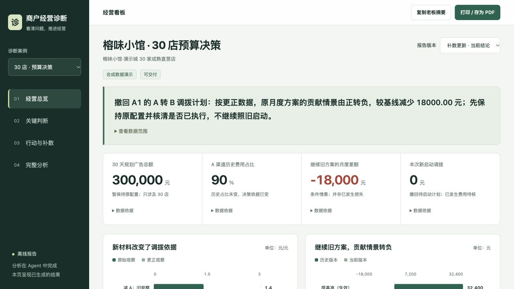

# 商户经营诊断 Skill

把店铺公开信息和经营周报交给 Agent，得到有证据的经营诊断、定向补数清单和行动方案。适用于商家运营、KA、BD 的客户沟通与经营复盘。

**当前版本 v1.4：Agent 负责分析，Python 负责读取、计算和校验，网页负责展示结果。**

## 先看效果

- [打开经营看板](https://fishinlab666.github.io/merchant-diagnosis-demo/reports/merchant-diagnosis-v1.4.html)：可切换案例、原方案与补数后的改判，展开证据和完整报告。
- [查看 Skill 规则](.agents/skills/merchant-diagnosis/SKILL.md)
- [下载完整 Skill ZIP](https://github.com/fishINlab666/merchant-diagnosis-demo/raw/refs/heads/main/releases/merchant-diagnosis-v1.4.zip)



案例均为合成材料，已有 Codex 实际分析记录，尚无商家执行效果。30 店案例保留原方案的月度贡献测算，并展示补充数据转负后如何撤回建议；四店案例展示乱格式周报、门店差异与缺成本处理。贡献测算不等于净利润或已实现收益。

## 业务流程

1. **公开初诊**：从菜单、价格、评价和店铺资料找到具体问题，给出先行动作。
2. **定向补数**：只索取会改变经营决定的数据，解释每项数据的用途。
3. **接收周报**：理解不同表头、工作表、单位与统计口径，保留字段来源和缺口。
4. **经营诊断**：实际计算，比较原因和策略；新增证据可保留、调整或撤回初诊。
5. **行动与复盘**：明确负责人、投入、月度情景和停止条件，导出可发给老板的报告。

支持文本、CSV／TSV、XLSX、文本 PDF；扫描件、图片和链接按宿主能力处理。不能可靠解释的字段会定向追问，不承诺任意文件都能无条件解析。

## 五分钟试用

下载 ZIP 并完整解压，或克隆本仓库。将 `merchant-diagnosis/` 放入 Agent 的技能目录；本仓库已在 `.agents/skills/` 放置完整包。需要能读取文件、运行 Python 3.10+ 的 Agent 环境。

在仓库根目录安装依赖：

```sh
python3 -m pip install -r .agents/skills/merchant-diagnosis/requirements.txt
```

在该项目的新会话里发送：

```text
使用 merchant-diagnosis Skill，演示“榕味小馆 30 店”案例。
读取该 Skill 的 examples/chain/raw/ 原始材料，按阶段独立分析并实际计算。
不要读取 examples/showcase/、numeric/ 或既有报告作为参考答案。
生成适合给商家老板看的经营看板，重点回答：
1. 最值得优先解决的问题是什么？
2. 怎么调整，月度经营贡献可能变化多少？
3. 先做什么、缺什么数据、什么时候继续或停止？
过程简洁展示“读取材料 → 经营判断 → 行动方案”。
将本次报告、计算、校验及看板保存在新的运行目录，最后给出看板文件。
明确这是合成案例及条件测算。
```

分析自己的商家时，用自己的店铺资料、周报和目标替换上述示例输入。只有公开资料时先做初诊与补数，不模拟客户已提供内部数据。

## 如果只是想查看或导出示例

在线经营看板已经可以直接查看。也可在仓库根目录运行：

```sh
python3 .agents/skills/merchant-diagnosis/scripts/export_report.py \
  --config .agents/skills/merchant-diagnosis/examples/showcase/catalog.json \
  --output dashboard.html
```

这条命令导出已有分析快照，**不会启动一次新的 AI 分析**。网页没有上传或分析入口，新材料需在 Agent 中处理后重新导出。

## 验证与兼容性

- 当前 v1.4 在 Codex 上使用合成材料实跑；74 项 Python 测试通过。
- 其他宿主的安装路径和能力边界见[兼容说明](.agents/skills/merchant-diagnosis/references/compatibility.md)。Claude、Kimi、DeepSeek、WorkBuddy 尚未完成本项目逐端验收。
- v1.4 由所选 Agent 提供模型与工具执行能力，不自带模型 API 接入器。
- 网页的桌面／手机预览和主要交互已检查；系统浏览器双击打开、打印分页和 PDF 保存仍待实机验证。
- 测试命令：`python3 -m unittest discover -s .agents/skills/merchant-diagnosis/tests -v`。

## 希望你帮忙看什么

1. 初诊是否让商家觉得切中问题？补数是否解释清楚会改变什么决定？
2. 换一份不同格式的周报，字段解释、计算和缺口处理是否可靠？
3. 建议是否具体到可以试行？反面证据是否能真正改变结论？
4. 经营看板能否支持一次清楚、有说服力的客户沟通？

欢迎通过 [Issues](https://github.com/fishINlab666/merchant-diagnosis-demo/issues) 反馈，附上运行宿主、复现步骤和脱敏后的问题片段即可；不要提交客户原始数据或密钥。

## 目录与历史版本

| 位置 | 内容 |
| --- | --- |
| `.agents/skills/merchant-diagnosis/` | 当前 v1.4 完整 Skill、规则、脚本、测试与合成案例 |
| `public/reports/` | 当前经营看板、核对数据、文件指纹与预览图 |
| `releases/merchant-diagnosis-v1.4.zip` | 当前可分发完整包 |
| `legacy/kimi-api-skill/` | 早期 Kimi API 专用实现，保留用于历史参考 |
| `releases/merchant-diagnosis.skill` | 早期版本的打包文件；试用当前版本请用 v1.4 ZIP |
| `src/` | 早期网页 Demo；网站首页仍保留这一历史界面 |

当前演示请使用上方的经营看板链接。旧网页的交互不代表当前 Skill 的分析流程。
