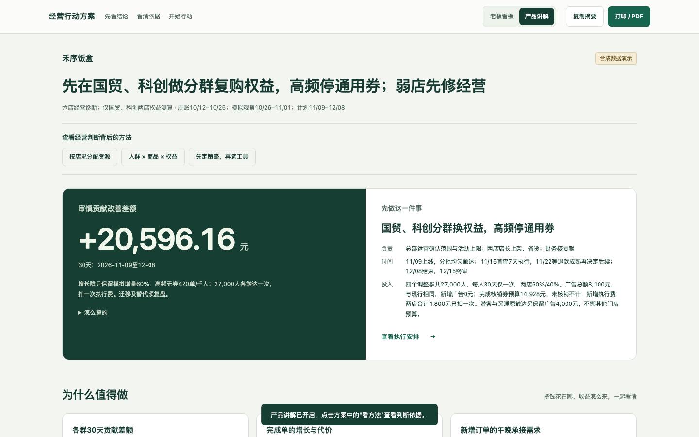
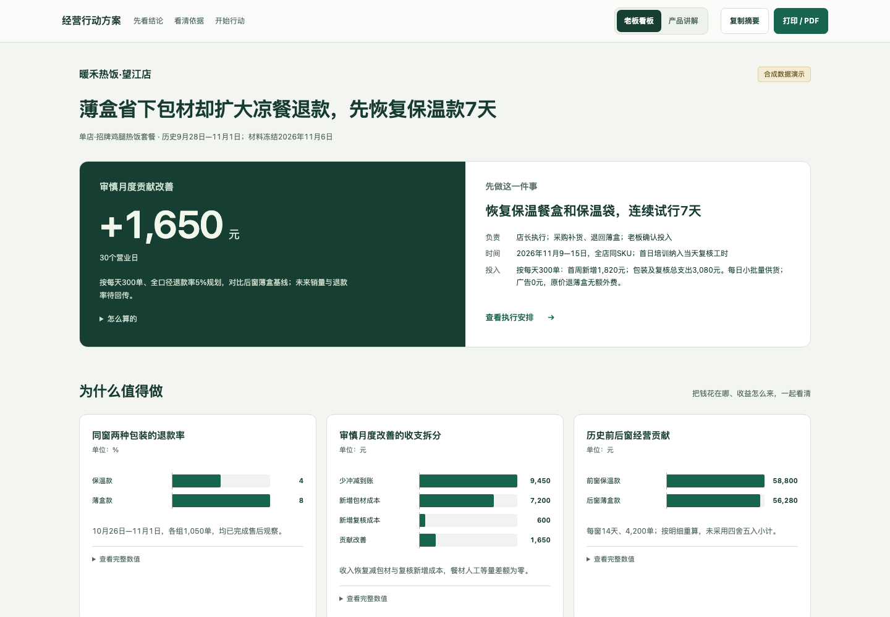
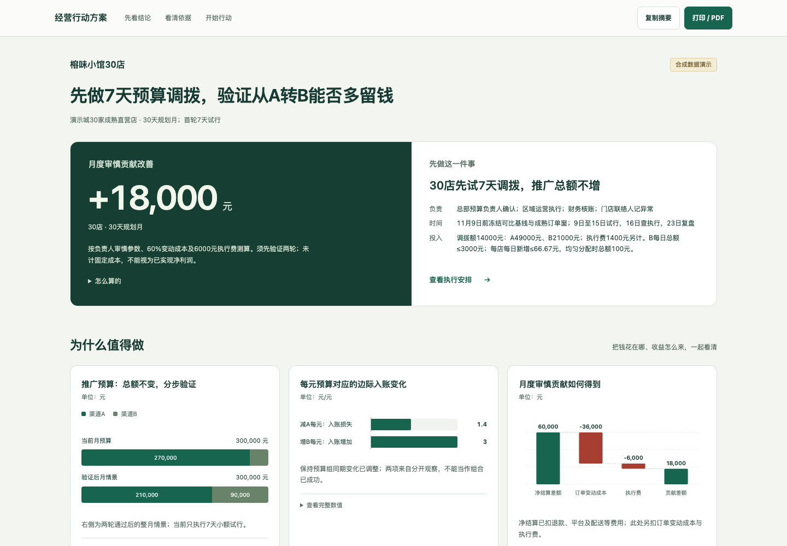
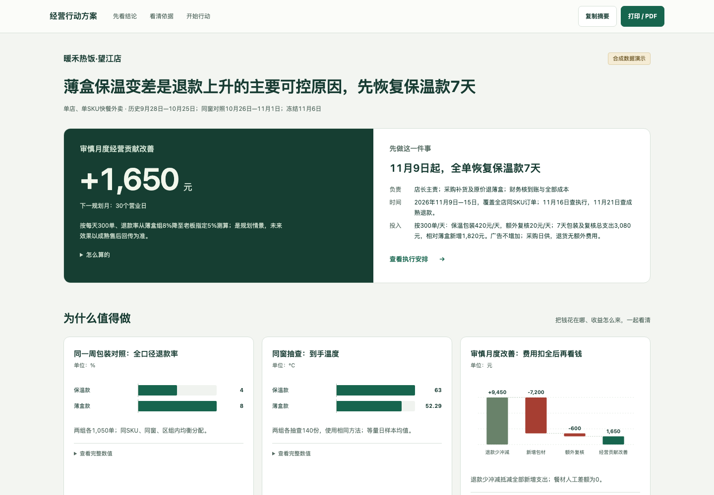

# 商户经营诊断 Skill · 1.8.3

把店铺资料和现有周报交给 Agent，得到一页「发现、钱账、先做什么」的老板看板。支持单店、连锁、有投放和无投放场景；老板已说明的口径直接采用，缺数只暂停受影响的测算。

[打开老板看板](https://fishinlab666.github.io/merchant-diagnosis-demo/reports/audience-chain-v183.html) · [打开产品讲解](https://fishinlab666.github.io/merchant-diagnosis-demo/reports/audience-chain-v183.html?view=explain) · [下载 v1.8.3](releases/merchant-diagnosis-v1.8.3.zip) · [验收记录](ACCEPTANCE.md)



产品面向商户经营诊断、执行与复盘，展示模式统一称「老板看板／产品讲解」。老板看板先给发现、钱账和行动；切换产品讲解后，点击方案中的「看方法」，查看材料依据、经营判断、方法来源和对应执行。两种视图共用同一份报告和计算结果。

默认分析读取 [阿里 KA 打法一页纸](.agents/skills/merchant-diagnosis/references/ali-ka-playbook.md)：净GMV拆因子、工具预算、门店四象限、JBP/追加投入。连锁或有投放先读；建议阈值不冒充作者历史制度，默认运行会冻结全文。

本版从新安装包重新生成禾序饭盒合成六店案例，人群观察与权益试行仅覆盖国贸／科创两店。六个互斥人群逐项对应商品、权益、选择理由和验收方式，包含不补贴的决定；金额按对应运行的计算呈现，不把部分门店观察外推整个品牌。所有原表、分组观察和计划测算均为合成材料，不是阿里历史业绩或已实现的商家收益。

## 哪些是作者的 KA 经验

[KA 经营打法](.agents/skills/merchant-diagnosis/references/ka-playbook.md)是默认分析实际读取的规则文件：按增长与收益质量给不同门店不同资源，串起人群、商品与权益，再通过诊断、培训、品牌接口人和回传推进执行。每一节写明依据、选择、动作和补数用途，单店或无投放商家只使用相关分支。

原经历中的平台 UE 已改写为商户贡献；有限加投、执行留痕和扩围条件属于复盘后的产品化补强。默认分析继续读取冻结的方法全文，操作仍是准备、计算、导出三步。

1.8 由 Agent 为分店资源、人群权益、策略工具、执行复盘分别保存采用／改写／缺数据／不适用记录。讲解从本轮采用记录生成最多三个证据圈点，其余方法可展开查看；不会为缺数据的方法补造采用记录。程序校验覆盖、来源定位与输出关联，业务判断仍须对照原材料复核，不能由字段完整推定结论正确。

## 安装

下载并解压 [v1.8.3 安装包](releases/merchant-diagnosis-v1.8.3.zip)，或使用仓库中的完整 `.agents/skills/merchant-diagnosis/`。将完整的 `merchant-diagnosis/` 放入项目目录：Codex 用 `.agents/skills/merchant-diagnosis/`；Claude Code 用 `.claude/skills/merchant-diagnosis/`。安装路径不等于宿主验收；各轮 Codex CLI 的场景结果见验收记录，Claude Code 本轮未测。

[v1.7.2 安装包](releases/merchant-diagnosis-v1.7.2.zip)保留为历史版本，不包含本版方法圈点与人群交互。

需要 Python 3.10+。以 Codex 目录为例，安装一次依赖：

```sh
cd .agents/skills/merchant-diagnosis
python3 -m venv .venv
.venv/bin/python -m pip install -r requirements.txt
```

安装后执行技能脚本统一使用技能目录的 `.venv/bin/python`。Claude Code 使用对应安装目录。

## 复制这段话开始

```text
使用 merchant-diagnosis，分析技能目录 examples/audience-chain/raw/ 的 public.md、definitions.md、manager-notes.md、禾序饭盒_混排周报与人群观察.xlsx 四份材料。
这是新的独立合成演示实例；只读原始材料，不读既有报告或验算答案。
按默认 quick 流程完成实际计算，直接给我老板看板 report.html。
先说最值得做的事；主卡用本次策略在审慎情况下的30天贡献改善差额，再给负责人和止损线。
按材料判断不同门店和人群适合什么商品权益，保留不补贴的决定；核清去重人数、商家承担费用、容量和一次性执行费。
保存四类方法的真实使用记录，关联本轮证据与实际动作，导出老板看板／产品讲解。
把本次文件保存在新的运行目录；遇到缺口仅暂停受影响的金额，其余继续交付。
```

Agent 完成读取材料、判断并计算、导出 HTML 三个核心动作；这不等于三次工具或模型调用。产物在本轮新目录的 `report.html`，可用浏览器打开、转发或打印；`method-usage.json` 留存方法依据。你不用逐项复制 JSON 或填方法表。

## 换成自己的材料

将提示词中的路径换成店铺资料、老板口径和现有周报，并说明本轮目标。不要求固定表头。仅有公开资料时先给初诊和定向补数，不编内部营收或利润；图片、扫描件和在线页面由宿主获取与识别。

自带材料都在技能目录的 `examples/` 下：

| 场景 | 原始材料目录 |
| --- | --- |
| 六店经营与人群×商品×权益 | `examples/audience-chain/raw/` |
| 连锁餐饮 | `examples/chain/raw/` |
| 单店外卖与包装取舍 | `examples/packaging/raw/` |
| 六店分层、局部缺成本 | `examples/segmented/raw/` |
| 无投放宠物洗护 | `examples/pet-care/raw/` |

[Skill 使用说明](.agents/skills/merchant-diagnosis/README.md)含独立 API 入口、文件范围与更正数据的用法。示例均为模拟商家；软件、原生 Agent 模型执行、独立 API 与商家效果分开验收。宿主记录的 `model_calls=0` 仅表示脚本未额外调用 API，不表示 Agent 未使用模型；尚无真实商家执行效果。

## 本版展示与实跑

[连锁人群看板](public/reports/audience-chain-v183.html) · [单店看板](public/reports/single-v183.html) · [API 分析＋Agent 整理看板](public/reports/api-chain-v183.html) · [完整演示视频](public/media/first-run-v183.mp4)



新安装包独立 Codex 会话：连锁 353.8 秒，单店 307.27 秒；各轮命令与返工数量见验收记录，无须体验者手改 JSON。录屏 1:55，原片 464.36 秒，仅将 354.08 秒等待压为5秒；顶部显示真实耗时。展示老板结论、三个方法圈点、六个人群方案和冻结打法一页纸上下半部。

独立 API 业务结果经反馈后通过；最后纯 API 文案修订被复核误拦，最终客户页面由 Agent 沿用已通过的分析整理并重新导出。模型配置、各轮调用和验收边界见 [1.8.3 验收记录](public/evidence/v1.8.3/README.md)。账户可用模型需自行确认；本轮保留所有失败记录，不能由一次通过保证任何模型和材料都一次成功。

## 展示层与历史版本

[演示首页](https://fishinlab666.github.io/merchant-diagnosis-demo/)是固定产品展示页，打开报告或切换讲解不会启动新的分析；新材料由 Agent 或独立 API 处理后再导出。`src/` 保留早期网页源码，当前发布用 `python3 scripts/build-showcase.py` 构建静态展示，不依赖前端框架。

以下两份老板看板、截图与录屏均为 **1.7 历史产物**，保留原验收范围，不重新标成 1.8 的方法或人群交互成果：

[1.7 连锁看板](public/reports/chain.html) · [1.7 单店看板](public/reports/single.html) · [1.7 首次运行录屏](public/media/first-run.mp4)




录屏为真实 Codex CLI 会话：原始全程约 202 秒，等待段 1.25 倍速，交付片 2:50；过程中包含模型自行修复，详见验收记录。以上为历史录像；本版新录像在上方。历史 v1.4 报告及各版安装包继续保留。
